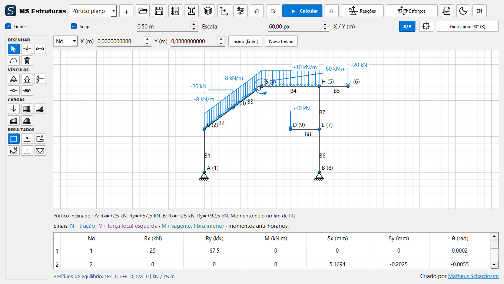

# MS Estruturas

**Engenharia Civil e desenvolvimento de software aplicados à análise estrutural.**

Aplicação desktop desenvolvida por **Matheus Schardosim** em Python para modelar estruturas de barras, aplicar vínculos e carregamentos e interpretar reações, esforços internos e deslocamentos.

**Versão 1.0.3 · Windows 10/11 de 64 bits · Português e inglês**



## O projeto

O MS Estruturas conecta minha formação em Engenharia Civil pela UFRGS ao desenvolvimento de ferramentas para rotinas técnicas. O projeto reúne modelagem estrutural, cálculo numérico, interface gráfica, exportação de resultados, documentação e distribuição em um instalador para Windows.

O objetivo é organizar o caminho entre a definição de um modelo e a leitura dos seus resultados, em uma ferramenta visual que permita explorar diferentes configurações e conferir o comportamento das estruturas.

## Recursos

- Modelagem de vigas, pórticos planos, treliças, grelhas e arcos discretizados em barras.
- Definição de nós, barras, apoios, molas, rótulas, materiais, seções e carregamentos, conforme a tipologia.
- Análise elástica linear de primeira ordem pelo método da rigidez direta.
- Visualização de reações, deslocamentos e diagramas de esforços; deformada nas tipologias suportadas.
- Biblioteca de exemplos para explorar e conferir resultados.
- Salvamento de projetos e exportação de resultados em PDF, PNG e CSV.
- Interface em português e inglês, temas claro e escuro e preferências persistentes.

## Instalação e guias

[**Baixar o instalador e os guias da versão mais recente →**](https://github.com/SCHARDOSIMM/ms-estruturas/releases/latest)

Os arquivos da versão são disponibilizados na área de **Releases** deste repositório:

| Arquivo | Conteúdo |
| --- | --- |
| `MS-Estruturas-Setup.exe` | Instalador para Windows de 64 bits; não exige instalar Python. |
| `Guia.de.Uso.-.MS.Estruturas.-.PT-BR.pdf` | Guia em português, com 24 páginas. |
| `User.Guide.-.MS.Estruturas.-.EN.pdf` | Guia em inglês, com 24 páginas. |
| `SHA256SUMS.txt` | Hashes para conferir a integridade dos três arquivos. |

Baixe o instalador nos anexos da release, execute-o e abra o atalho **MS Estruturas**. Os arquivos automáticos “Source code” contêm os fontes do repositório; para instalar o aplicativo, escolha o arquivo `.exe`.

O executável ainda não possui assinatura digital. Confira a origem e a integridade do arquivo antes de executá-lo.

## Tecnologias e competências aplicadas

| Tecnologia / área | Aplicação no projeto |
| --- | --- |
| Python | Modelos, cálculo e integração da aplicação. |
| PyQt5 / Qt | Interface desktop e desenho interativo. |
| ReportLab | Geração de relatórios PDF. |
| PyInstaller e Inno Setup | Empacotamento e instalador para Windows. |
| Análise estrutural | Rigidez direta, condições de contorno e interpretação de resultados. |
| Testes automatizados | Conferências de cálculo, exemplos e comportamento da aplicação. |

## Hipóteses e limites

O aplicativo utiliza análise elástica linear, de primeira ordem e com pequenos deslocamentos. Não implementa análise P-Δ, flambagem por autovalores, plasticidade, combinações de carregamento, peso próprio automático ou dimensionamento normativo. Arcos são discretizados em barras retas. Diagramas e extremos dependem da amostragem adotada.

Confira geometria, unidades, vínculos, rigidezes, equilíbrio e resultados de forma independente. A ferramenta não substitui a verificação pelo responsável técnico. Os guias detalham as hipóteses e os limites de cada tipologia.

## Executar a partir dos fontes

Requer Python 3.10 ou superior. No PowerShell, na raiz do repositório:

```powershell
python -m venv .venv
.\.venv\Scripts\python -m pip install -r requirements.txt
.\.venv\Scripts\python -m estrutural
```

Para executar os testes:

```powershell
.\.venv\Scripts\python -m unittest discover -s tests -q
```

O código de domínio e cálculo está em `estrutural/core`; a interface está em `estrutural/ui`. As instruções de empacotamento estão em [docs/INSTALADOR.md](docs/INSTALADOR.md).

## Licenciamento

Copyright (C) 2026 Matheus Schardosim. O código do MS Estruturas é disponibilizado sob a GNU General Public License versão 3 (GPL-3.0-only). Consulte [LICENSE](LICENSE). Os componentes de terceiros mantêm suas respectivas licenças e avisos em `empacotamento/avisos`.

## Autor

**Matheus Schardosim** · Engenharia Civil pela UFRGS

[LinkedIn](https://www.linkedin.com/in/matheus-schardosim/) · [GitHub](https://github.com/SCHARDOSIMM) · [E-mail](mailto:schardosimmatheus@gmail.com)
